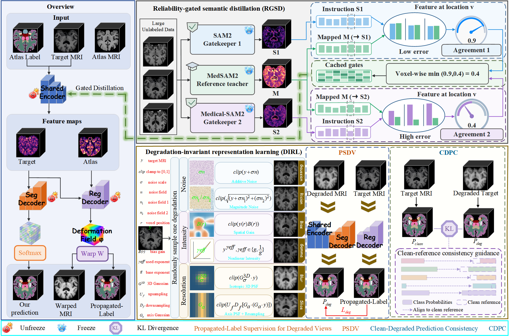

# One-shot, Dual Signals: Less Appearance, More Anatomy for 3D Medical Image Segmentation

## Overview

<p align="center"></p>

## Code structure

- `train.py`: atlas training.
- `test_and_save_results.py`: evaluation with trained registration and segmentation checkpoints.
- `models.py`, `medsam2_align.py`, and `degrade_aware.py`: the main network and auxiliary training components.
- `data/`, `utils/`, and `sam2/`: data processing and model dependencies.

## Dependencies

The code is configured with the following environment:

- Python 3.11
- PyTorch 2.11.0 + CUDA 12.8
- torchvision 0.26.0
- torchaudio 2.11.0

## Installation

First, install a PyTorch build compatible with your GPU by following the [official PyTorch instructions](https://pytorch.org/get-started/locally/).

Then, install the remaining dependencies:

```bash
pip install -r requirements.txt
```

## Dataset preparation

Training expects exactly atlas image/label pairs, unlabeled target images, and validation images with labels. A typical layout is:

```text
<DATA_ROOT>/
  atlas/
    vol/
      case_01_vol.nii.gz
    seg/
      case_01_seg.nii.gz
  train/
    vol/
      case_101_vol.nii.gz
      ...
  test/
    vol/
      case_201_vol.nii.gz
      ...
    seg/
      case_201_seg.nii.gz
      ...
```

## Pretrained checkpoints and gate cache

Three teacher checkpoints are required for the default cached-gate training path:

| Checkpoint | Role | Argument | Download |
| --- | --- | --- | --- |
| MedSAM2 checkpoint | Main alignment teacher | `--medsam2_ckpt` | [Download](https://github.com/bowang-lab/MedSAM2) |
| SAM2 checkpoint | Gate reference teacher | `--gate_sam2_ckpt` | [Download](https://github.com/facebookresearch/sam2) |
| Medical-SAM2 checkpoint | Gate reference teacher | `--gate_medsam2_ckpt` | [Download](https://github.com/SKKU-IBE/Medical-SAM2GUI/) |

Place the downloaded checkpoints in the `checkpoints/` directory and specify their paths using the corresponding command-line arguments.


## Training

```bash
python train.py \
  --train_path "<DATA_ROOT>/train/vol/*" \
  --test_path "<DATA_ROOT>/test/vol/*" \
  --atlas_dir "<DATA_ROOT>/atlas" \
  --medsam2_ckpt "<WEIGHTS>/MedSAM2_latest.pt" \
  --gate_sam2_ckpt "<WEIGHTS>/sam2.1_hiera_large.pt" \
  --gate_medsam2_ckpt "<WEIGHTS>/MedSAM2_pretrain.pth" \
```

## Citation

The BibTeX entry will be added when the manuscript is publicly available.
